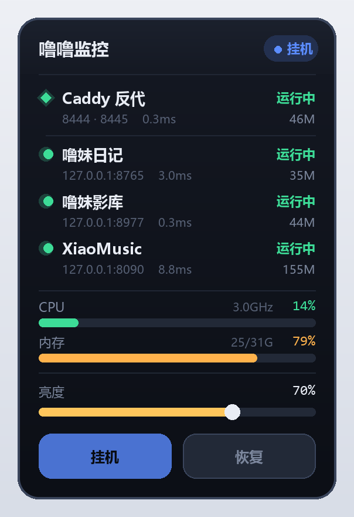

# 噜噜监控（lulu-watch）

Windows 桌面小贴纸。透明圆角卡片，常驻右下角，实时显示本机电源模式、Caddy 入口与两个本地服务的存活状态、CPU 与内存占用，并可一键切换「挂机 / 恢复」电源方案。



浅色 / 深色桌面下的两种状态见 `preview_dark.png`、`screenshot.png`。

## 功能

| 区域 | 内容 |
|---|---|
| 顶部徽章 | 当前电源方案名称，颜色随方案变化（挂机=蓝、恢复=绿、守夜=紫、高性能=橙） |
| Caddy 入口 | 8444 / 8445 哪个站点在听、握手耗时；菱形圆点 + 分隔线，表示它是下面两个服务共用的入口 |
| 服务状态 | 噜妹日记（8765）、噜妹影库（8977）是否监听、握手耗时 ms |
| 指标 | CPU 占用 + 当前频率、内存占用 + 已用/总量 |
| 按钮 | 「挂机」「恢复」一键切换电源方案，当前方案按钮高亮 |
| 托盘图标 | 右下角常驻，三条色条 = Caddy / 日记 / 影库 的存活状态（绿/红），也是挂件被盖住时的唤出入口 |

交互：
- 左键拖动 = 移动位置（位置写入 `%APPDATA%\lulu-watch.json`，下次启动还原；改名前的 `lulu-widget.json` 也认）
- 左键点按钮 = 切换方案
- 右键挂件 = 始终置顶 / 立即刷新 / 居中显示 / 隐藏到托盘 / 退出挂件
- 托盘图标：左键单击 = 显示|隐藏挂件，右键 = 状态速览 / 始终置顶 / 切换挂机·恢复 / 退出

默认**不置顶**，不会一直压在其他窗口前面。需要固定在最前时，在任一处菜单勾「始终置顶」，状态会记进配置文件。

## 目录结构

```
lulu-watch/
├── widget.py              主程序（单文件，无其他模块依赖）
├── 启动挂件.cmd            双击启动（pythonw 无控制台窗口）
├── requirements.txt       psutil + pillow + pystray
├── power-modes/           配套电源方案切换脚本（挂件按钮等价物）
│   ├── 挂机模式.cmd        CPU 5~60%，显示器 10 分钟关，不休眠，硬盘 20 分钟停转
│   ├── 恢复模式.cmd        平衡方案
│   ├── 守夜模式.cmd        低功耗守夜
│   ├── 开黑模式.cmd        高性能
│   └── rebuild-idle-scheme.ps1   新机器上重新生成自定义挂机方案，新 GUID 自动回填 widget.py
├── preview.png            预览图（浅色底）
├── preview_dark.png       预览图（深色底）
└── screenshot.png         实机截图
```

## 安装与运行

```cmd
pip install -r requirements.txt
```

双击 `启动挂件.cmd`。它用 `%~dp0` 定位自身目录，优先调用 PATH 里的 `pythonw`，找不到时回退到本机 `C:\Python314\pythonw.exe`。

也可以直接命令行：

```cmd
pythonw widget.py            :: 无控制台启动
python  widget.py --preview  :: 只渲染预览图 preview.png / preview_dark.png，不开窗口
```

开机自启：把 `启动挂件.cmd` 的快捷方式放进
`%APPDATA%\Microsoft\Windows\Start Menu\Programs\Startup\`

窗口位置与「始终置顶」存在 `%APPDATA%\lulu-watch.json`。这个挂件早先叫 lulu-widget，改名后旧的 `%APPDATA%\lulu-widget.json` 仍会被读取一次，位置和置顶不用重设；下次拖动或改置顶时才写到新文件名。

## 换机器时需要改的地方

代码里所有与本机绑定的值集中在文件头部，改这 4 处即可：

1. **服务端口** —— `SERVICES = [("噜妹日记", 8765), ("噜妹影库", 8977)]`
2. **Caddy 入口端口** —— `CADDY_PORTS = [8444, 8445]`（两个服务经 Caddy 反代对外的 TLS 端口）。不跑 Caddy 的机器上，把 `build_image()` 里「Caddy 入口」那一段连同它下面那条分隔线一起删掉，并把 `H` 减去 42、后续的 y 坐标各自上移（`rows`、`192`、`gauge` 的 206/216/236/246、按钮的 272/310）；或者干脆保留这一行，让它显示「未运行」当作一个明确的口子。
3. **电源方案 GUID** —— `SCHEMES` 字典与 `MODE_IDLE` / `MODE_NORMAL`。系统内置方案 GUID 是通用的：

   | 方案 | GUID |
   |---|---|
   | 平衡 | `381b4222-f694-41f0-9685-ff5bb260df2e` |
   | 高性能 | `8c5e7fda-e8bf-4a96-9a85-a6e23a8c635c` |
   | 节能 | `a1841308-3541-4fab-bc81-f71556f20b4a` |
   | 挂机（自定义） | `22f98355-2f49-49ce-8a7f-c138149382ce` ← 只在本机存在 |

   自定义挂机方案不是系统自带的。新机器上执行：

   ```cmd
   powershell -ExecutionPolicy Bypass -File power-modes\rebuild-idle-scheme.ps1
   ```

   脚本会复制「平衡」方案、套上 CPU 5~60% / 显示器 10 分钟关 / 不休眠 / 硬盘 20 分钟停转 / PCIe 最大省电的参数，并把生成的新 GUID 自动替换进同级 `widget.py`（备份为 `widget.py.bak`）。方案已存在时只重设参数，不会重复创建。
4. **字体** —— `_font()` 里优先用微软雅黑（`msyh.ttc` / `msyhbd.ttc`），缺失时降级到黑体、宋体、默认字体。

## 实现要点

- **按物理像素渲染**：启动时 `SetProcessDpiAwareness(1)` 取系统 DPI，`SCALE = dpi/96`，窗口尺寸与所有坐标都乘 `SCALE`，避免 4K/150% 缩放下文字被系统二次拉伸发虚。
- **透明圆角**：窗口 `-transparentcolor #ff00ff` 抠图；圆角蒙版单独用 L 通道超采样（`SS` 倍）后二值化阈值化，避免缩放后边缘残留洋红像素。渐变背景层按 `SCALE` 缓存复用，不每帧重绘。
- **采样与绘制解耦**：后台线程每 1.2s 采一次 `psutil` + 三次 TCP 握手（Caddy 两个端口 + 两个服务端口），放进 `queue`；主线程 `after(150ms)` 非阻塞取最新值重绘。
- **Caddy 为什么单独一行**：8444 与 8445 是**同一个 Caddy 进程里的两个站点**，不是两个独立服务。它一挂，手机和电视两个入口同时失联，而本机 8765 / 8977 两个端口还都通 —— 这种情况在只看端口的面板上看不出来。所以 Caddy 单列一行，用**菱形**圆点与下面两个**圆形**服务点区分，并在入口与后端之间加一条更淡的分隔线，表示「这两条服务挂在它后面」。三态：两个端口都在 = 运行中（绿）、只在一个 = 部分（琥珀）、都不在 = 未运行（红）。
- **切换方案不卡界面**：点击后先乐观更新徽章颜色，再后台 `subprocess` 调 `powercfg /setactive`，完成后回读真实值。
- **层级**：默认不置顶（`-topmost` 关闭，不做定时强制）。需要常驻最前时由用户勾选「始终置顶」，此时才每 2.5s 用 `SetWindowPos(HWND_TOPMOST)` 重申一次（其他程序的置顶窗会压过 tk 自己的属性）。
- **托盘**：`pystray` 在独立线程跑消息循环。无边框窗口不在任务栏显示，一旦被别的窗口盖住就点不到，托盘图标是唯一的唤出入口。托盘回调不能直接碰 tk 控件（tk 非线程安全），统一投进 `queue`，由主线程 `_poll` 消费；菜单文本用 callable，每次弹出时实时求值，所以状态是活的。
- **托盘图标兼作状态灯**：Caddy 或任一服务的存活状态一变，重画图标（三条色条由绿转红，上=Caddy、中=日记、下=影库），不用展开挂件也知道有没有东西挂了。

## 已知限制

- 仅 Windows（依赖 `ctypes.windll`、`-transparentcolor`、`powercfg`）。
- 无边框窗口不出现在任务栏，被其他窗口盖住时只能从托盘图标唤出（曾试过 Ctrl+Alt 全局热键，已弃用）。
- Win11 上新注册的托盘图标可能被折叠进「^ 溢出区」，拖到任务栏上固定一次即可。
- 切换电源方案本身不需要管理员权限，但如果目标方案被组策略锁定，`powercfg /setactive` 会静默失败，徽章会回读显示真实方案。
- 探测是 TCP 握手，只能判断端口是否在监听，不代表服务内部逻辑健康；Caddy 同理，只看 8444/8445 在不在听，不代表证书和反代规则都对。
- 启动异常写到同目录 `error.log`；托盘初始化失败（例如没装 pystray）写 `tray-error.log`，挂件本体照常可用。

## 相关背景

这套东西的起因：机器在切换电源模式（守夜 CPU 20% → 手动切高性能 100%）瞬间断电。推断是 6 年半的 650W ATX 2.4 电源在频率/电压突跳时触发 OCP 保护，毫秒级掉电、无 bugcheck、无 dump。挂件的用途是上班时段把机器稳定压在低功耗档维持两个本地服务，避免反复在两端剧烈切换。
