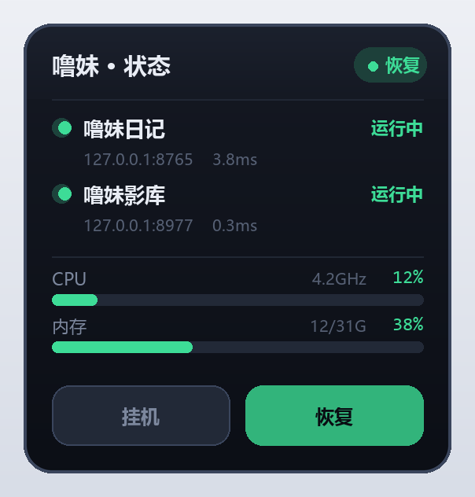

# 噜妹状态挂件（lulu-widget）

Windows 桌面小贴纸。透明圆角卡片，常驻右下角，实时显示本机电源模式、两个本地服务的存活状态、CPU 与内存占用，并可一键切换「挂机 / 恢复」电源方案。



浅色 / 深色桌面下的两种状态见 `preview_dark.png`、`screenshot.png`。

## 功能

| 区域 | 内容 |
|---|---|
| 顶部徽章 | 当前电源方案名称，颜色随方案变化（挂机=蓝、恢复=绿、守夜=紫、高性能=橙） |
| 服务状态 | 噜妹日记（8765）、噜妹影库（8977）是否监听、握手耗时 ms |
| 指标 | CPU 占用 + 当前频率、内存占用 + 已用/总量 |
| 按钮 | 「挂机」「恢复」一键切换电源方案，当前方案按钮高亮 |

交互：
- 左键拖动 = 移动位置（位置写入 `%APPDATA%\lulu-widget.json`，下次启动还原）
- 左键点按钮 = 切换方案
- 右键 = 立即刷新 / 居中显示 / 退出挂件

## 目录结构

```
lulu-widget/
├── widget.py              主程序（单文件，无其他模块依赖）
├── 启动挂件.cmd            双击启动（pythonw 无控制台窗口）
├── requirements.txt       psutil + pillow
├── power-modes/           配套电源方案切换脚本（挂件按钮等价物）
│   ├── 挂机模式.cmd        CPU 5~60%，显示器 10 分钟关，不休眠，硬盘常转
│   ├── 恢复模式.cmd        平衡方案
│   ├── 守夜模式.cmd        低功耗守夜
│   ├── 开黑模式.cmd        高性能
│   └── rebuild-idle-scheme.ps1   新机器上重新生成自定义挂机方案，新 GUID 自动回填 widget.py
├── preview.png            预览图（浅色底）
└── screenshot.png         实机截图
```

## 安装与运行

```cmd
pip install -r requirements.txt
```

双击 `启动挂件.cmd`。它用 `%~dp0` 定位自身目录，优先调用 PATH 里的 `pythonw`，找不到时回退到本机 `C:\Python314\pythonw.exe`。

也可以直接命令行：

```cmd
pythonw widget.py            :: 无控制台启动
python  widget.py --preview  :: 只渲染预览图 preview.png / preview_dark.png，不开窗口
```

开机自启：把 `启动挂件.cmd` 的快捷方式放进
`%APPDATA%\Microsoft\Windows\Start Menu\Programs\Startup\`

## 换机器时需要改的地方

代码里所有与本机绑定的值集中在文件头部，改这 3 处即可：

1. **服务端口** —— `SERVICES = [("噜妹日记", 8765), ("噜妹影库", 8977)]`
2. **电源方案 GUID** —— `SCHEMES` 字典与 `MODE_IDLE` / `MODE_NORMAL`。系统内置方案 GUID 是通用的：

   | 方案 | GUID |
   |---|---|
   | 平衡 | `381b4222-f694-41f0-9685-ff5bb260df2e` |
   | 高性能 | `8c5e7fda-e8bf-4a96-9a85-a6e23a8c635c` |
   | 节能 | `a1841308-3541-4fab-bc81-f71556f20b4a` |
   | 挂机（自定义） | `79d386e3-3601-482d-aeb4-cc38e16c3d8f` ← 只在本机存在 |

   自定义挂机方案不是系统自带的。新机器上执行：

   ```cmd
   powershell -ExecutionPolicy Bypass -File power-modes\rebuild-idle-scheme.ps1
   ```

   脚本会复制「平衡」方案、套上 CPU 5~60% / 显示器 10 分钟关 / 不休眠 / 硬盘常转的参数，并把生成的新 GUID 自动替换进同级 `widget.py`（备份为 `widget.py.bak`）。方案已存在时只重设参数，不会重复创建。
3. **字体** —— `_font()` 里优先用微软雅黑（`msyh.ttc` / `msyhbd.ttc`），缺失时降级到黑体、宋体、默认字体。

## 实现要点

- **按物理像素渲染**：启动时 `SetProcessDpiAwareness(1)` 取系统 DPI，`SCALE = dpi/96`，窗口尺寸与所有坐标都乘 `SCALE`，避免 4K/150% 缩放下文字被系统二次拉伸发虚。
- **透明圆角**：窗口 `-transparentcolor #ff00ff` 抠图；圆角蒙版单独用 L 通道超采样（`SS` 倍）后二值化阈值化，避免缩放后边缘残留洋红像素。渐变背景层按 `SCALE` 缓存复用，不每帧重绘。
- **采样与绘制解耦**：后台线程每 1.2s 采一次 `psutil` + 两次 TCP 握手，放进 `queue`；主线程 `after(150ms)` 非阻塞取最新值重绘。
- **切换方案不卡界面**：点击后先乐观更新徽章颜色，再后台 `subprocess` 调 `powercfg /setactive`，完成后回读真实值。
- **强制置顶**：其他程序的置顶窗口会盖掉 tk 的 `-topmost`，每 2.5s 用 `SetWindowPos(HWND_TOPMOST)` 系统级重申一次。

## 已知限制

- 仅 Windows（依赖 `ctypes.windll`、`-transparentcolor`、`powercfg`）。
- 切换电源方案本身不需要管理员权限，但如果目标方案被组策略锁定，`powercfg /setactive` 会静默失败，徽章会回读显示真实方案。
- 服务探测是 TCP 握手，只能判断端口是否在监听，不代表服务内部逻辑健康。
- 启动异常会写到同目录 `error.log`。

## 相关背景

这套东西的起因：机器在切换电源模式（守夜 CPU 20% → 手动切高性能 100%）瞬间断电。推断是 6 年半的 650W ATX 2.4 电源在频率/电压突跳时触发 OCP 保护，毫秒级掉电、无 bugcheck、无 dump。挂件的用途是上班时段把机器稳定压在低功耗档维持两个本地服务，避免反复在两端剧烈切换。
